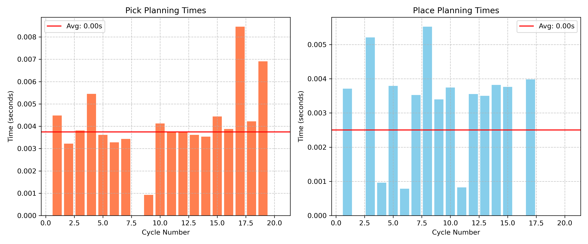
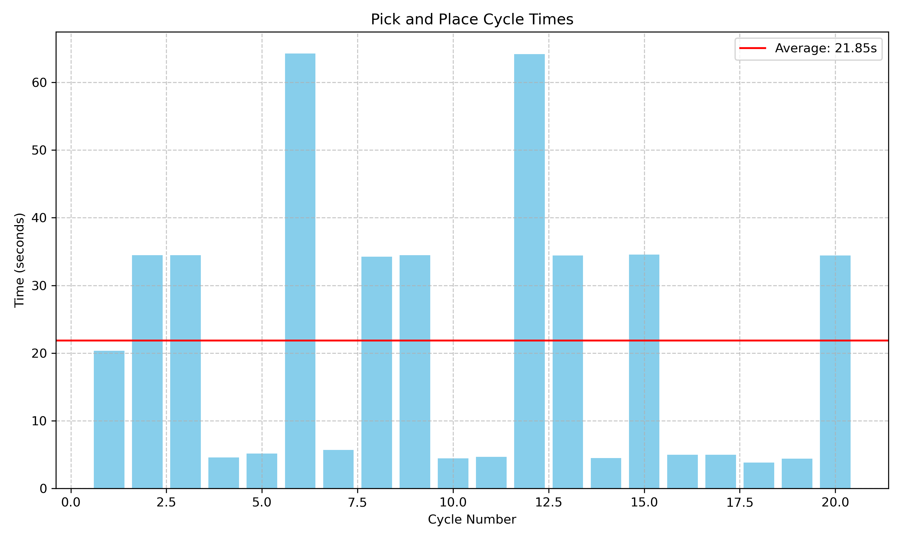
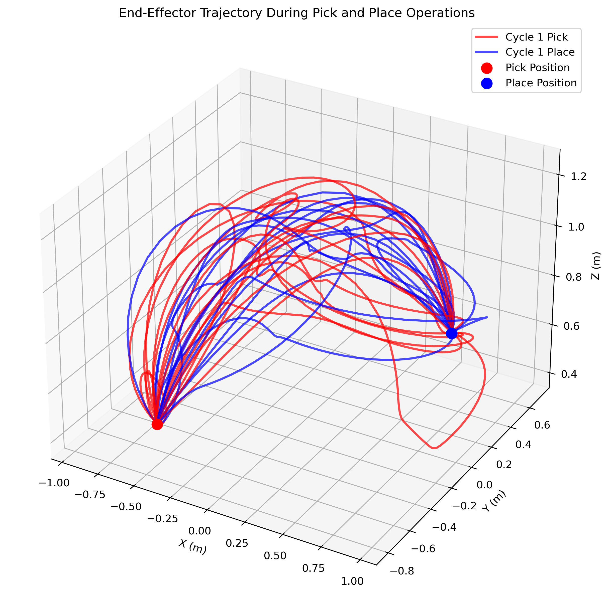
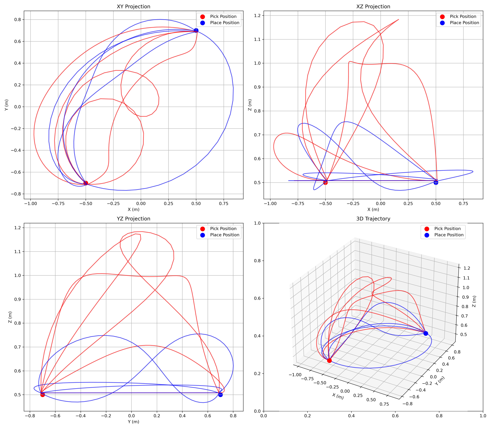
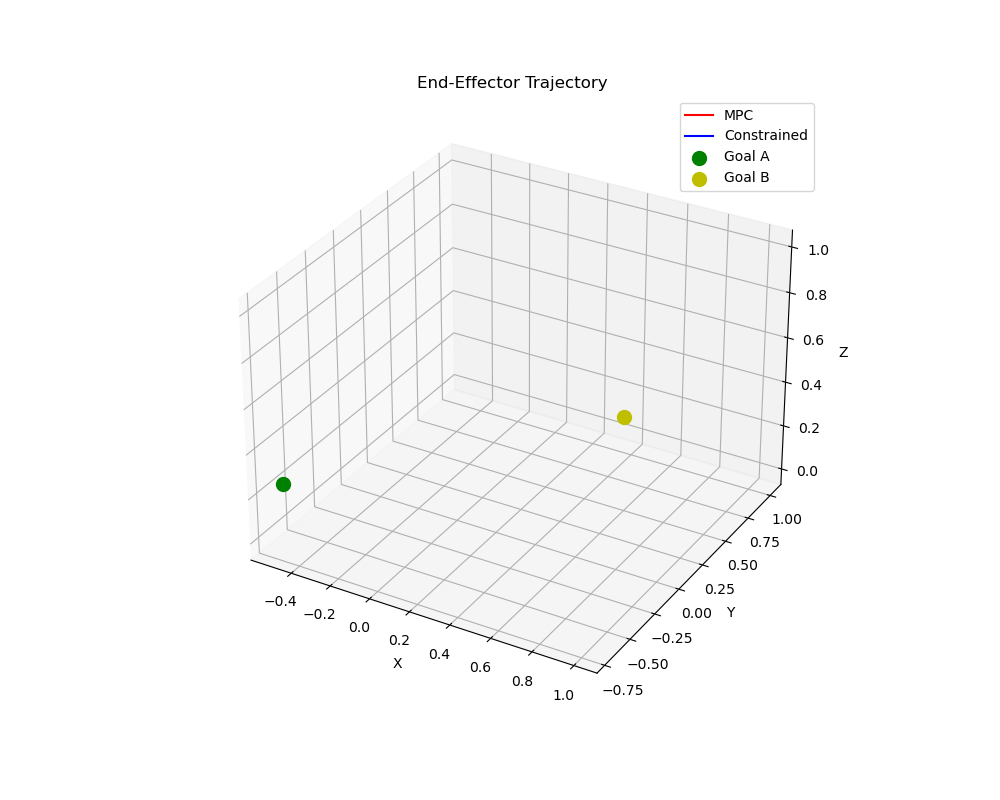

# GPU Motion Planning for a UR5e on a Linear Gantry

cuRobo motion generation for an extended-DOF industrial cell: a UR5e with a Robotiq
gripper mounted on a linear rail, simulated in MuJoCo and driven over ROS 2.

This is the codebase behind **"Industrial Robot Motion Planning with GPUs: Integration of
cuRobo for Extended DOF Systems"** ([arXiv:2508.04146](https://arxiv.org/abs/2508.04146)),
work done as a UC Berkeley master's capstone with Vention.


## Why extended DOF is the interesting case

A 6-DOF arm bolted to a rail is kinematically redundant: a continuum of (rail position, arm
configuration) pairs reaches any given end-effector pose. Choosing among them, collision-free,
is most of the planning problem, and it is not something a planner that takes goal
*configurations* can help with. cuRobo solves collision-free IK and trajectory optimization
jointly on the GPU, so the redundancy is resolved as part of planning rather than before it.

## Measured performance

20 completed pick-and-place cycles, UR5e on gantry, Jetson Orin NX:

| | Mean | Std |
|---|---|---|
| **Planning time** | **3.1 ms** | 2.0 ms |
| Pick planning | 3.7 ms | 1.9 ms |
| Place planning | 2.5 ms | 1.9 ms |
| Execution time | 4.95 s | |
| **Full cycle time** | **9.90 s** | 4.37 s |

Raw numbers: [`performance_statistics.txt`](src/vention_curobo/vention_curobo/data/performance_statistics.txt)

Planning is roughly 0.03% of cycle time here. That is the point worth taking away: for an
industrial cell, planning latency is amortised to nothing and **execution time is the metric
that matters**. Motion quality, not planning speed, is what a GPU trajectory optimizer buys you.

| Planning time distribution | Cycle time distribution |
|---|---|
|  |  |

| End-effector trajectory | Projections |
|---|---|
|  |  |

MPC under task constraints:



## Layout

```
assets/      MuJoCo models and meshes: UR5e, 2F-85/2F-140 grippers, D435i, gantry, cell scenes
config/      demos.yml plus cuRobo world and robot configs
motion_planner/
mujoco_scripts/  standalone MuJoCo drivers and plotting
src/         ROS 2 packages: vention_curobo, curobo_action, motion_plan, gantry_moveit_config
util/
```

## Running a demo

`config/demos.yml` is the master configuration. Each entry pairs a cuRobo world and robot
config with a MuJoCo scene:

```yaml
ur5e_with_gantry:
  curobo:
    world_config_file: config/curobo/world_config/gantry_table.yml
    robot_config_file: ur5e_robotiq_2f_140_x.yml
  mujoco:
    xml_path: assets/ur5e/scene_ur5e_2f140_obj_gantry.xml
    meshes:
      - bs_link: assets/ur5e/mesh/gantry/bs_link.STL
```

```bash
cd ~/ros2_ws
colcon build --symlink-install
source install/setup.bash
ros2 launch curobo_api curobo.launch.py demo:=ur5e_with_gantry
```

## Requirements

ROS 2, MuJoCo, cuRobo with a CUDA-capable GPU. Developed and benchmarked on a Jetson Orin NX.

## Citation

```bibtex
@article{abuelsamen2025curobo,
  title  = {Industrial Robot Motion Planning with GPUs: Integration of cuRobo for Extended DOF Systems},
  author = {Abuelsamen, Luai and Rana, Harsh and Lu, Ho-Wei and Tang, Wenhan and Priyadarshini, Swati and Gomes, Gabriel},
  journal = {arXiv preprint arXiv:2508.04146},
  year   = {2025}
}
```
